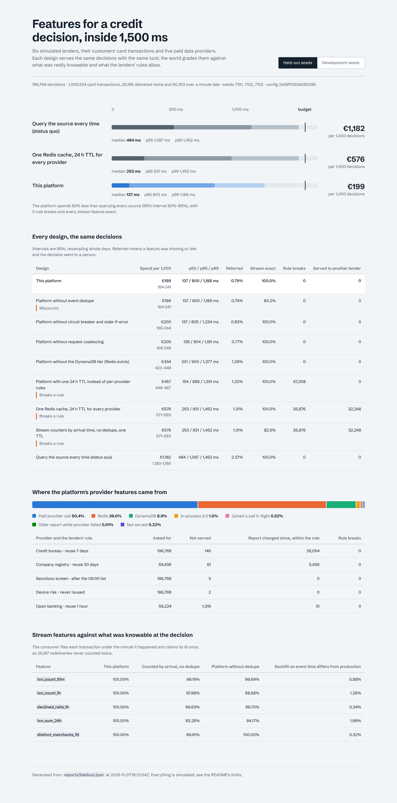
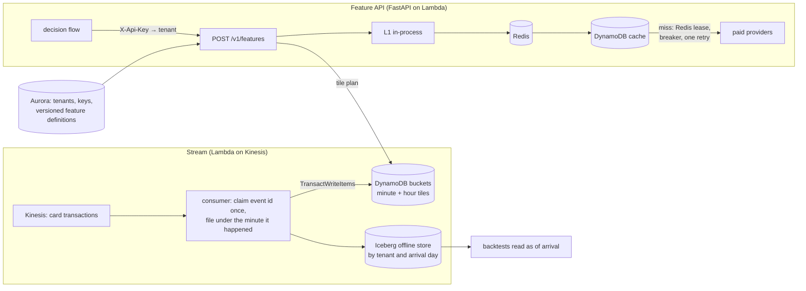
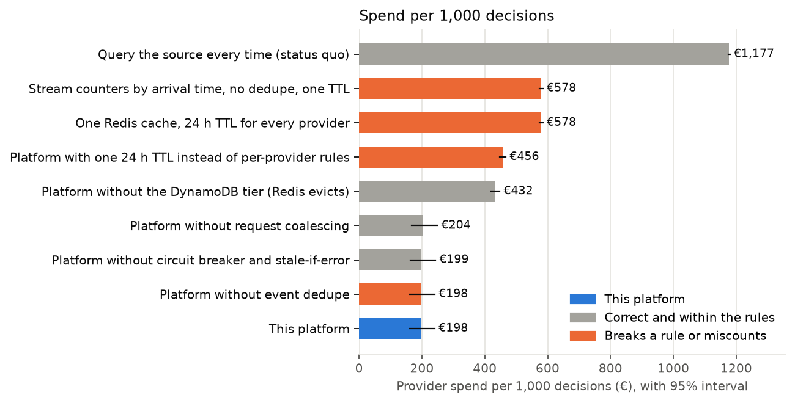
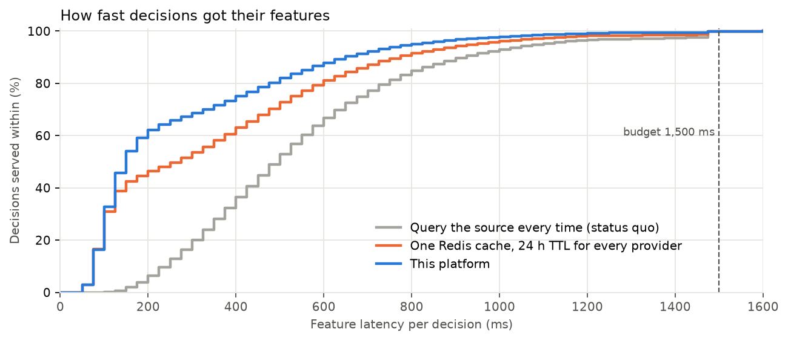

# decision-feature-platform

Real-time features for credit and fraud decisions on AWS serverless. Card transactions stream in
through Kinesis and land as tiled minute and hour buckets in DynamoDB. Paid data-provider calls
(bureau, company registry, sanctions, device, open banking) sit behind an in-process, Redis and
DynamoDB cache that follows each lender's reuse rules. A feature registry runs on Aurora PostgreSQL,
and point-in-time reads come from an Iceberg offline store. Everything is tested against a simulated
lender world whose truth the platform never sees.

Built by [Manoj Kumar Prakash](https://www.linkedin.com/in/manoj-kumar-prakash-52b7a01b6/) as a
portfolio project for the Senior Backend Engineer role in Taktile's Team Atlas. The lenders, customers,
transactions and providers are simulated (see [Limits](#limits)). The code is written to run against
real ones.



## The problem

A decision flow asks for twenty features and has about a second and a half to get them. Three things
make that hard, and each one fails quietly:

- **The stream lies a little.** Kinesis delivers at least once, so a retried batch arrives twice. Mobile
  and terminal events arrive minutes or hours late. A counter that adds whatever arrives, in the minute
  it arrives, drifts away from what actually happened. Nothing errors.
- **Provider data costs money and has rules.** A bureau pull costs about a euro. A lender may reuse it
  for 7 days, but a sanctions screen must post-date the morning's list publication, and an open-banking
  balance is stale after an hour. A report one lender bought must never be served to another. A single
  cache TTL saves money by breaking some of those rules, and a cache keyed by national ID leaks one
  lender's paid report to the next.
- **Backtests drift from production.** A backfill that filters on event time counts late events that
  had not arrived when production made the decision. The model then trains on values production never
  served.

## What is here



- **Stream features** (`src/dfp/stream`, `src/dfp/features`). The consumer claims each event id and adds
  the event to its minute bucket and hour tile in one DynamoDB transaction, so a redelivered batch never
  counts twice and a crash cannot half-apply an event. A window is read as its full hour tiles plus the
  minute buckets at its two ragged edges: a 7-day window is at most three range queries, and the answer
  is exact ([ADR 1](docs/adr/0001-tiled-windows-on-event-time.md), [ADR 2](docs/adr/0002-dedupe-by-transactional-claim.md)).
  On a failure the handler reports the first failed record, so Lambda retries from there.
- **Provider features** (`src/dfp/cache`, `src/dfp/providers`). Each lender's reuse rules live in
  `config/compliance.yml`: maximum age, a daily publication a response must follow, and how much older a
  report may be when the provider is failing. The cache tiers are in-process LRU, then Redis, then
  DynamoDB, which survives Redis evictions. Keys always carry the tenant. Concurrent misses take a Redis
  lease, so a double-submitted application pays once. A circuit breaker fails fast during an outage
  ([ADR 3](docs/adr/0003-cache-tiers-follow-the-lenders-rules.md), [ADR 4](docs/adr/0004-coalescing-breaker-and-stale-if-error.md)).
- **Registry** (`src/dfp/registry`): SQLAlchemy Core on Aurora PostgreSQL (SQLite in unit tests). API keys
  are stored hashed, and the tenant always comes from the key. Feature definitions are immutable, and a
  changed spec gets a new version.
- **Offline store** (`src/dfp/offline`): an Iceberg table of events as they arrived, partitioned by
  tenant and arrival day (SQLite catalog locally, Glue on AWS, so Athena reads it). `pit.as_of` filters
  on arrival time and matches production; `pit.leaky` is the naive backfill, kept to show the skew.
- **Infrastructure** (`infra/template.yaml`): AWS SAM with Kinesis on demand, the consumer with
  `ReportBatchItemFailures`, bisect-on-error and an SQS on-failure destination, the API on an HTTP API
  with provisioned concurrency, three DynamoDB tables with TTL, ElastiCache Serverless (Valkey), Aurora
  Serverless v2, and an iterator-age alarm. `cfn-lint` runs in CI.
- **The lab** (`src/dfp/sim`): a world of 6 lenders, 3,000 customers and about 340,000 card transactions
  per seed, with late events, redeliveries, double submits, provider latency and failures, outages, and
  Lambda cold starts. Ten designs replay it with the same luck ([ADR 5](docs/adr/0005-the-lab.md)).

## Results

<!-- results:start -->
_From the development seeds (1, 2, 3), run once; generated by `python -m dfp.cli report`._

Against querying every source on every decision, the platform cut provider spend by **83%** (95% interval 80%–86%), from €1,177 to €198 per 1,000 decisions, and median feature latency from 481 ms to 137 ms, while serving every stream feature exactly and no report the lenders' rules forbid. A generic 24-hour Redis cache saves less (51%) and breaks those rules 35,675 times, plus 29,770 reports served to a lender that did not buy them. Counting the stream by arrival time without dedupe gets 17.4% of decisions' stream features wrong.



Seeds 1, 2, 3 · 196,728 decisions · 1,016,901 card transactions (25,211 delivered twice, 91,399 more than a minute late) · 9,000 customers at 6 lenders · config `2e69ff063d083296`. Intervals are 95%, resampling whole days.

| Design | Spend per 1,000 decisions | p50 / p95 / p99 | Decisions referred | Stream features exact | Rule breaks | Reports served to another lender |
|---|---|---|---|---|---|---|
| Query the source every time (status quo) | €1,177 (1,175–1,180) | 481 / 1,084 / 1,452 ms | 2.37% (2.03%–2.76%) | 100.0% (100.0%–100.0%) | 0 | 0 |
| One Redis cache, 24 h TTL for every provider | €578 (573–585) | 254 / 934 / 1,452 ms | 1.36% (1.10%–1.64%) | 100.0% (100.0%–100.0%) | 35,675 | 29,770 |
| Stream counters by arrival time, no dedupe, one TTL | €578 (573–585) | 254 / 934 / 1,452 ms | 1.36% (1.10%–1.64%) | 82.6% (81.9%–83.4%) | 35,675 | 29,770 |
| **This platform** | €198 (162–241) | 137 / 799 / 1,181 ms | 0.78% (0.50%–1.08%) | 100.0% (100.0%–100.0%) | 0 | 0 |
| Platform without event dedupe | €198 (162–241) | 137 / 799 / 1,181 ms | 0.78% (0.50%–1.08%) | 84.3% (83.7%–85.0%) | 0 | 0 |
| Platform without request coalescing | €204 (167–250) | 137 / 803 / 1,185 ms | 0.75% (0.48%–1.05%) | 100.0% (100.0%–100.0%) | 0 | 0 |
| Platform without the DynamoDB tier (Redis evicts) | €432 (420–448) | 200 / 899 / 1,379 ms | 1.32% (1.04%–1.62%) | 100.0% (100.0%–100.0%) | 0 | 0 |
| Platform with one 24 h TTL instead of per-provider rules | €456 (447–467) | 154 / 887 / 1,370 ms | 1.25% (1.01%–1.48%) | 100.0% (100.0%–100.0%) | 67,272 | 0 |
| Platform without circuit breaker and stale-if-error | €199 (164–243) | 137 / 804 / 1,209 ms | 0.81% (0.53%–1.11%) | 100.0% (100.0%–100.0%) | 0 | 0 |

**Where the platform's provider features came from**: provider 50.5%, redis 38.9%, dynamodb 8.8%, l1 1.0%, coalesced 0.5%, missing 0.2%, stale if error 0.0%.

| Provider | Asked for | Not served | Served a report that changed since, within the lender's rule | Rule breaks |
|---|---|---|---|---|
| Credit bureau | 196,728 | 123 | 24,567 | 0 |
| Company registry (KYB) | 57,478 | 57 | 5,777 | 0 |
| Sanctions screen | 196,728 | 4 | 0 | 0 |
| Device risk | 196,728 | 2 | 0 | 0 |
| Open banking | 58,724 | 1,309 | 32 | 0 |

| Stream feature | Platform exact | Arrival-time counters, no dedupe | Platform without dedupe | Backfill on event time differs from what production served |
|---|---|---|---|---|
| `txn_count_10m` | 100.00% | 99.21% | 99.73% | 0.91% |
| `txn_count_1h` | 100.00% | 98.18% | 98.81% | 1.31% |
| `declined_ratio_1h` | 100.00% | 99.67% | 99.73% | 0.33% |
| `txn_sum_24h` | 100.00% | 83.35% | 84.25% | 1.99% |
| `distinct_merchants_7d` | 100.00% | 99.92% | 100.00% | 0.32% |

The platform's consumer applied 1,016,753 events and dropped 25,207 redeliveries.


<!-- results:end -->

## The designs

| Design | What it does |
|---|---|
| Query the source every time | The status quo: one indexed Aurora query for the stream features and a paid call for every provider feature. |
| One Redis cache, 24 h TTL | What most teams add first: one TTL for every provider, keyed by the person. |
| Stream counters by arrival time | Kinesis consumer that adds each record to the minute it arrived, without dedupe. |
| **This platform** | Event-time tiles with a dedupe claim, per-provider rules, tenant-keyed L1/Redis/DynamoDB tiers, lease coalescing, breaker and stale-if-error. |
| Ablations | The platform without dedupe, without coalescing, without the DynamoDB tier, with one TTL, and without breaker and stale-if-error. |

## Run it

```bash
python -m venv .venv && . .venv/bin/activate
pip install -e ".[dev]"
pytest -q                                  # about 5 s; moto, fakeredis and SQLite stand in for AWS
python -m dfp.cli run dev                  # three development seeds, about 3.5 min on 3 cores
python -m dfp.cli gate dev                 # thresholds in config/gates.yml
python -m dfp.cli report                   # REPORT.md, figures, and the results block above
cd web && npm ci && npm run dev            # the dashboard
sam build -t infra/template.yaml && sam deploy --guided   # on AWS
```

To run the registry tests against PostgreSQL, set `DFP_TEST_PG_URL=postgresql+psycopg://...`. CI does
this with a PostgreSQL service.

## Limits

- **The world is simulated.** Transaction rates, arrival delays, redelivery rates, provider latencies,
  costs, error rates and how often records change are plausible settings in `config/world.yml`, not
  measurements. The ranking of the designs depends on those settings, so read the numbers as "what
  happens under these assumptions". Change them and rerun.
- **AWS is modelled in the lab.** The simulation uses the production code paths (consumer, tile plan,
  cache tiers, freshness rules, breaker) on in-memory stores, with each tier's latency drawn from the
  world. The DynamoDB, Redis and Iceberg adapters are tested against moto, fakeredis and a local
  catalog. None of this has run on a real AWS account, and Redis memory is modelled as a key limit.
- **Reuse rules are examples.** Real contracts differ by provider, country and lender. The rules are
  config so a lender can set its own.
- **The breaker is shared** across containers in the lab. In production each container has its own,
  which opens a little later.
- **"Served a report that changed since"** counts bureau and registry reports that were still within
  the lender's reuse window when a newer record existed. The contract allows that. A lender that wants
  fresher data shortens the window and pays more.

## Repository map

`src/dfp` is the platform. `src/dfp/sim` is the lab: `world.py` simulates, `designs.py` replays,
`evaluate.py` grades, `run.py` runs seed sets behind the held-out lock, and `report.py` writes
reports. `config/` holds every setting, `tests/` holds the tests, `web/` is the dashboard,
`infra/` is the SAM template, and `docs/adr` holds the decisions.
AGENTS.md lists the invariants and SKILLS.md the repeatable tasks.
